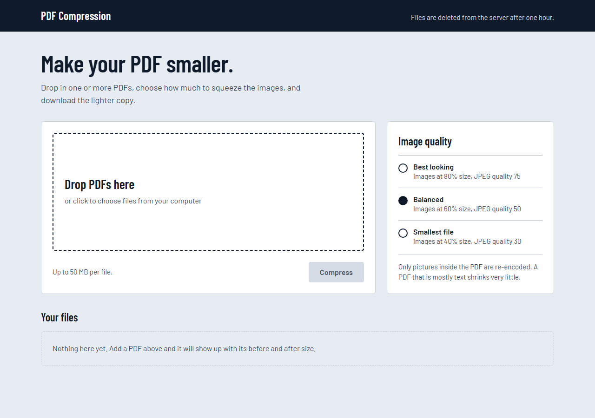

# PDF Compression

A web app that makes PDF files smaller. Upload one or more PDFs, choose how much to shrink the images inside them, and download the compressed copies.

Live demo: https://pdf-compression.onrender.com (hosted on Render's free plan, so the first request after a period of inactivity can take up to a minute).

<div align="center">
    
</div>

## How it works

For each upload the server runs two methods on the original file and keeps the smallest valid result.

1. **Lossless.** Compresses page content streams and merges duplicate objects. Annotations, links, forms and metadata are untouched.
2. **Images + lossless.** Does the lossless pass, then downscales embedded images and re-encodes them as JPEG, but only where that makes the image smaller. Images with transparency masks or decode arrays, indexed or 1-bit images, and images under 64 px are left alone.

Every output is reopened and its page count compared with the original before it is offered for download, so a damaged file is never returned. If no method reduces the size, the app says so and shows the comparison.

The quality level only affects embedded images. A PDF that is mostly text shrinks very little.

| Level | Image size | JPEG quality |
| ----- | ---------- | ------------ |
| Low (Best looking) | 80% | 75 |
| Medium (Balanced) | 60% | 50 |
| High (Smallest file) | 40% | 30 |

## Features

- Batch upload with a progress bar per file, driven by a background job.
- Per-method comparison with a separate download for each result.
- Server-side validation: PDF header check, 50 MB limit per file, encrypted files rejected.
- Rate limit of 30 uploads per minute per IP address.
- Results are deleted from the server after one hour.
- Keyboard-accessible controls, visible focus, and reduced-motion support.

## Getting started

Requires Python 3.12 or later.

```bash
git clone https://github.com/Divyansh3105/PDF-Compression.git
cd PDF-Compression
python -m venv .venv
.venv/Scripts/activate        # macOS/Linux: source .venv/bin/activate
pip install -r requirements.txt
python compress.py
```

Open http://127.0.0.1:5000/ in a browser.

### Docker

```bash
docker build -t pdf-compression .
docker run -p 8000:8000 pdf-compression
```

The container runs gunicorn with one worker and four threads, bound to `$PORT` (default 8000). It must stay at one worker process because job state is held in memory. Scaling out would need a shared store such as Redis.

### Tests

```bash
pip install pytest
pytest
```

## API

| Method and path | Description |
| --------------- | ----------- |
| `POST /compress` | Multipart form with `file` and `compression_level` (`low`, `medium` or `high`). Validates the upload and returns `202` with `{"job_id": "..."}`. |
| `GET /status/<job_id>` | Returns `state` (`queued`, `running` or `done`), `progress` (0 to 100) and, when done, a `result` object with the sizes, percentage saved, winning method, per-method comparison and download URLs. |
| `GET /download/<file_id>` | Downloads a result. An optional `name` query parameter sets the file name. |
| `GET /og.png` | Social sharing image. |

## Configuration

| Setting | Where | Default |
| ------- | ----- | ------- |
| `FLASK_DEBUG=1` | environment | off (never enable on a public host) |
| `PORT` | environment, read by the Docker image | 8000 |
| Upload limit, result lifetime, image settings | constants in `compress.py` | 50 MB, 1 hour, see table above |

## Deployment

The repository includes a Dockerfile that works on any container host. The live demo runs on Render as a Docker web service with auto-deploy from `main`.

## Project structure

```
compress.py            Flask app, compression strategies and job handling
templates/index.html   Single-page interface
assets/og.png          Social sharing image
tests/                 pytest suite
Dockerfile             Production image (gunicorn)
PRODUCT.md             Users, purpose and product constraints
DESIGN.md              Visual design system
```

## Tech stack

Python, Flask, Flask-Limiter, pypdf and Pillow on the server. The interface is plain HTML, CSS and JavaScript, with GSAP and Lenis loaded from a CDN and Barlow from Google Fonts.

## Contributing

Pull requests are welcome. Please run `pytest` before submitting and keep changes focused.

## License

Released under the MIT License. See [LICENSE](LICENSE).

## Contact

Divyansh Garg, divyanshgarg3105@gmail.com, [@Divyansh3105](https://github.com/Divyansh3105)
